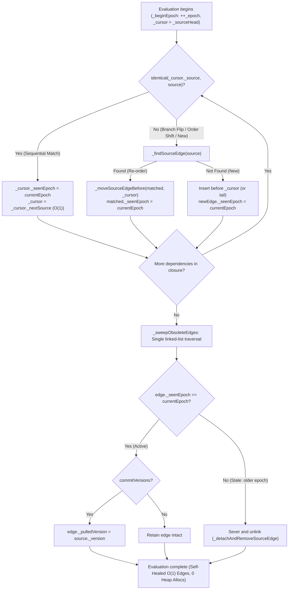

# Explicit Dependency Manifest and 1-Pass Epoch Sweeping Specification
## (Explicit Dependency Manifest: WhatVia, 1-Pass Epoch Sweeping, and Zero Ambient Tracking)

> **"Implicit global scopes may appear convenient to author, but they lose context across asynchronous boundaries and corrupt lexical scopes. A truly high-performance reactive system must operate via an explicit manifest (WhatVia) and monotonically incrementing epochs."**  
> — *What Framework Core Systems Group*

---

## 1. Overview and Background: The Structural Limits of Ambient Dynamic Tracking

Reactive architectures historically often adopted **ambient dynamic tracking** models for developer convenience. Under this approach, the runtime maintains an ambient reference to the currently executing reactive scope in a global pointer or thread-local storage (e.g., Dart `Zone` or a global `_currentScope` variable). Whenever an entity property (`.value` or `.data`) is dereferenced, the runtime covertly reads that ambient pointer and links an edge.

However, in large-scale production applications and high-throughput Flutter environments, ambient tracking exhibits severe architectural deficiencies:

1. **Hidden Overhead in Raw Reads**:
   Even pure inspection (`if (user.data == null)`) incurs the penalty of querying ambient scope stacks, executing null checks, and allocating/inserting listener nodes dynamically.
2. **Lexical Scope Escapes and Scope Leaks**:
   When asynchronous operations (`await`), deferred closures, or external event listener registrations occur inside a scope, unrelated property reads accidentally register as dependencies of surrounding computations.
3. **Memory Leaks and Ghost Computations from Stale Dependencies**:
   In conditional branches (`condition ? a : b`), when conditions flip, nodes from previously active branches (`b`) remain bound as listeners unless expensive differential reconciliation is performed, leading to zombie subscriptions and ghost recomputations.

The What Framework resolves these challenges using an **Explicit Dependency Manifest ([`WhatVia`](../../lib/src/engine/via.dart))** and a **1-Pass Epoch Sweeping** algorithm ([`_WhatViaEpochMixin`](../../lib/src/engine/_internal/_via.dart#L55)).

---

## 2. Dependency Registration Model Comparison: Ambient vs. WhatVia

```text
┌─────────────────────────────────────────────────────────────────────────────────┐
│            Ambient Scope Tracking vs. WhatVia Explicit Manifest                 │
├─────────────────────────────────────────────────────────────────────────────────┤
│                                                                                 │
│   [ Model A: Ambient Dynamic Tracking (Implicit Scope Lookups) ]                │
│   computed(() {                                                                 │
│     // Ambient scope lookups occur invisibly on thread-local stacks!            │
│     // a.data secretly registers itself with global _currentScope.              │
│     return a.data + b.data;                                                     │
│   });                                                                           │
│   * Defects: Raw read overhead, async escape bugs, impossible AST lints         │
│                                                                                 │
│   [ Model B: WhatVia Explicit Manifest (What Framework Standard) ]              │
│   computed((via) {                                                              │
│     // Explicit dependency registration strictly via injected via!              │
│     return via(a) + via(b);                                                     │
│   });                                                                           │
│   * Benefits: Raw reads (untracked(node)) are pure 0-overhead inlined calls,    │
│               compile-time AST verifiable, zero lexical leaks                   │
│                                                                                 │
└─────────────────────────────────────────────────────────────────────────────────┘
```

### 2.1 The Complete WhatVia Surface: Three Scoped Operations

Inside any reactive tracking scope ([`computed`](../../lib/src/what/computed.dart), [`switched`](../../lib/src/what/switched.dart), `RawViaTerminal`, `Effect`, or `WhatWidget.build`), dependencies are registered strictly through the injected [`WhatVia`](../../lib/src/engine/via.dart) instance:

1. **`via(what)` — Direct Payload Extraction with Short-Circuiting**:
   Registers `what` as an upstream dependency for the current evaluation epoch. If `what` contains valid data (`_ValidWhatState`), returns `T` directly. If `what` is empty or holds an error, throws an internal [`_ViaShortCircuit`](../../lib/src/engine/_internal/_via.dart#L44) sentinel to immediately bypass downstream calculation without running invalid logic.
2. **`via.state(what)` — Defensive State Inspection**:
   Registers `what` as an upstream dependency and returns its zero-allocation [`WhatState<T>`](../../lib/src/what/state.dart) container without short-circuiting, enabling exhaustive pattern matching (`state.match(data: ..., empty: ..., error: ...)`) inside derivations.
3. **`via.tether(tether)` — Declarative Lifecycle Binding**:
   Binds a non-propagating lifecycle node ([`Tether`](../../lib/src/engine/tether.dart)) to the enclosing scope's active/dormant state and epoch lifecycle.

### 2.2 Symmetrical Gateway: Tracked `via(...)` vs. Untracked `untracked(...)`

What establishes a completely symmetrical, zero-allocation gateway architecture:
- Inside reactive scopes (`computed`, `effect`, `build`): use **`via(node)`** and **`via.state(node)`** to register dynamic LPDAG edges.
- Outside reactive scopes (event handlers, imperative methods, tests): use **`untracked(node)`** and **`untracked.state(node)`** for 0-allocation raw reads with zero dependency tracking.

By keeping `What<T>` an opaque node handle with zero public read getters, What eliminates AI hallucinations and accidental unreactive leaks.

```dart
// 1. Pure raw read: 0 global scope lookups, 0 edge mutations, 0 heap allocations
final current = untracked(counter.what); 

// 2. Explicit registration within dynamic derivations:
final doubled = computed((via) {
  // Edge synchronization and epoch stamping occur atomically ONLY during via(counter)
  return via(counter.what) * 2;
});
```

Because of this separation, `untracked(...)` compiles down to direct memory access instructions via `@pragma('vm:prefer-inline')`, matching the performance of raw Dart instance field access ($O(1)$, nanosecond scale).

---

## 3. The 1-Pass Epoch Sweeping Algorithm

Dynamic branching refers to scenarios where the set of observed nodes changes dynamically at runtime depending on program logic:

```dart
final isDark = WhatController(false);
final darkTheme = WhatController(DarkTheme());
final lightTheme = WhatController(LightTheme());

final activeTheme = computed((via) {
  return via(isDark.what) ? via(darkTheme.what) : via(lightTheme.what);
});
```

* When `isDark == false`: `activeTheme` must observe only `isDark` and `lightTheme`.
* When `isDark` flips to `true`: The edge to `lightTheme` must detach immediately, and an edge to `darkTheme` must be synthesized.

### 3.1 Limitations of Bidirectional Set Diffing
Traditional reactive frameworks allocate previous and next dependency collections (`List<Source>` or `Set<Node>`) on every branch change, executing $O(N)$ or $O(N \log N)$ set difference algorithms. This introduces heap churn and GC pressure on hot paths.

### 3.2 1-Pass Monotonic Epoch Sweeping in What

What implements dependency tracking via [`_WhatViaEpochMixin`](../../lib/src/engine/_internal/_via.dart#L55) on an intrusive doubly linked list of [`_Edge`](../../lib/src/engine/_internal/_edge.dart#L17) structures (`_sourceHead`, `_sourceTail`, `_prevSource`, `_nextSource`). By tracking a monotonically incrementing integer field (`_epoch`) per node and a timestamp (`_seenEpoch`) on each edge, What eliminates set allocations and performs pruning in **zero heap allocations and $O(\text{edges})$ linear time**.

Furthermore, What incorporates an **$O(1)$ Sequential Cursor Fast-Path Optimization** for the 99% common case where dependency access order remains stable.

```text
[Phase 1: _beginEpoch()]
  currentEpoch = ++_epoch;
  _cursor = _sourceHead; // Reset cursor to head for O(1) sequential match

[Phase 2: During Evaluation via(source) Invocations]
  1. Fast-Path (O(1)):
     if (identical(_cursor._source, source)) {
       _cursor._seenEpoch = currentEpoch;
       _cursor = _cursor._nextSource; // Advance cursor sequentially
       return;
     }
  2. Slow-Path (Dynamic Branch Switch / Order Reorder):
     matchedEdge = _findSourceEdge(source);
     if (matchedEdge != null) {
       if (matchedEdge._seenEpoch != currentEpoch) {
         // Self-healing: relink matched edge before cursor to align list order
         if (_cursor != null) _moveSourceEdgeBefore(matchedEdge, _cursor);
         matchedEdge._seenEpoch = currentEpoch;
       }
     } else {
       // New dependency: insert before cursor (or at tail if cursor is null)
       newEdge = _cursor != null 
           ? _addAndAttachSourceEdgeBefore(source, _cursor)
           : _addAndAttachSourceEdge(source);
       newEdge._seenEpoch = currentEpoch;
     }

[Phase 3: _endEpoch() Single-Pass Sweeping (_sweepObsoleteEdges)]
  curr = _sourceHead;
  while (curr != null) {
    next = curr._nextSource;
    if (curr._seenEpoch != currentEpoch) {
      // Stale branch edge: detach immediately and unlink from source list!
      _detachAndRemoveSourceEdge(curr);
    } else if (commitVersions) {
      // Retained active edge: commit upstream version in the exact same pass!
      curr._pulledVersion = curr._source._version;
    }
    curr = next;
  }
```



#### Algorithmic Advantages
1. **$O(1)$ Sequential Cursor Matching**: When dependencies evaluate in the same order (the overwhelming majority of runs), dependency matching runs in true $O(1)$ time with zero linked-list search overhead.
2. **Zero Heap Allocation**: Never creates temporary `List` or `Set` objects; operates purely by updating `_seenEpoch` and intrusive pointer fields of existing `_Edge` instances.
3. **Deterministic Pruning**: Stale edges are severed synchronously in a single linked-list pass ($O(S)$). Unused branches never emit background invalidation pulses downstream.
4. **Combined Version Stamping**: In terminal nodes (`commitVersions: true`), upstream versions are committed during the sweeping traversal, avoiding separate post-processing passes.
5. **Cycle Immunity**: Circular dependencies during evaluation are intercepted immediately, raising an [`LpdagCycleError`](../../lib/src/engine/exception.dart#L74) rather than freezing in an infinite loop.

---

## 4. The Short-Circuiting Mechanics: `_ViaShortCircuit` and State Forwarding

When [`WhatVia.call`](../../lib/src/engine/via.dart#L95) evaluates an upstream node that is currently in an `Empty` or `Error` state, evaluating downstream user expressions (e.g. string formatting, arithmetic) is unsafe:

```dart
final profile = computed((via) {
  final user = via(userWhat); // If userWhat is Empty, continuing here would throw NullThrownError
  return 'Name: ${user.name}, Role: ${user.role}';
});
```

### 4.1 Sentinel Architecture: `_ViaShortCircuit`
To short-circuit execution cleanly and defensively:
1. `_WhatViaImpl.call(what)` reads `what._read()`.
2. If `_ValidWhatState`, returns the raw payload `s.data`.
3. If `Empty` or `Error`, throws [`_ViaShortCircuit(s)`](../../lib/src/engine/_internal/_via.dart#L44):
   ```dart
   final class _ViaShortCircuit implements Error {
     const _ViaShortCircuit(this.state);
     final _WhatState<Object?> state;
     @override
     StackTrace? get stackTrace => null;
   }
   ```
   - **Why `implements Error`**: Application code typically uses `try { ... } on Exception catch (e)`. By implementing `Error`, the sentinel bypasses ordinary exception handlers and bubbles directly to the enclosing engine pull wrapper.

### 4.2 Epoch Completion and State Forwarding
In [`_ComputedPullMixin`](../../lib/src/what/_internal/_computed.dart#L50):
```dart
} on _ViaShortCircuit catch (e) {
  succeeded = true;
  state = e.state._retype<T>();
} catch (error, stackTrace) {
  succeeded = false;
  state = _WhatState.fromCaught(error, stackTrace);
} finally {
  _endEpoch(currentEpoch, succeeded: succeeded, commitVersions: false);
}
```

1. **`on _ViaShortCircuit catch (e)` (Stack Trace Avoidance)**:
   Because short-circuiting represents a legitimate partial evaluation of the current active branch, `succeeded` is `true`. Catching the sentinel without a second `stackTrace` parameter ensures the Dart VM does not synthesize or allocate a `StackTrace` object.
   Consequently, `_endEpoch` successfully executes `_sweepObsoleteEdges`, pruning any edges that were not visited prior to the short-circuit point.
2. **`_WhatState.fromCaught` & Type-Preserving Retyping**:
   ```dart
   if (error is _ViaShortCircuit) {
     return error.state._retype<T>();
   }
   return _ErrorWhatState<T>(error, stackTrace);
   ```
   `error.state._retype<T>()` forwards the upstream `Empty` (preserving its `emptyReason`) or `Error` (preserving original error and stack trace) without re-allocating new error containers.

---

## 5. Decoupling Data and Lifecycle Planes: Tether and `via.tether()`

The What Framework physically separates two orthogonal planes across reactive topologies:

1. **Data Plane ([`What<T>`](../../lib/src/what/what.dart))**:
   - Nodes that compute values and propagate state changes downstream via the 2-Phase Push-Dirty / Lazy-Pull engine.
2. **Lifecycle Plane ([`Tether`](../../lib/src/engine/tether.dart))**:
   - Non-propagating nodes (`_isNewerThan() == false`) that never emit dirty pulses or version increments downstream.
   - They purely bind to the surrounding scope's active/dormant state and lifecycle termination driven by 1-Pass Epoch Sweeping.

```text
┌─────────────────────────────────────────────────────────────────────────────────┐
│             Data Plane (What) vs. Lifecycle Plane (Tether)                      │
├─────────────────────────────────────────────────────────────────────────────────┤
│                                                                                 │
│   [ Tracking Scope: computed / RawViaTerminal ]                                 │
│          │                                                                      │
│          ├─► via(sourceWhat) ──► Data Plane Edge (State Propagation)            │
│          │                                                                      │
│          └─► via.tether(effect) ─► Lifecycle Plane Edge (No Invalidation       │
│                                    Pushed to Parent Scope)                      │
│                                                                                 │
└─────────────────────────────────────────────────────────────────────────────────┘
```

### 5.1 Mechanics of `via.tether()` and Epoch Sweeping

```dart
final userSession = computed((via) {
  final user = via(authController.what);
  if (user.isVip) {
    // Tether a VIP-only real-time socket logging effect to the active scope
    via.tether(vipAnalyticsEffect);
  }
  return user.profile;
});
```

* **Conditional Lifecycle Binding**: When `user.isVip` evaluates to `true`, `vipAnalyticsEffect` receives the current epoch timestamp (`_seenEpoch`).
* **1-Pass Reclamation**: When the user changes to standard status, the subsequent evaluation turn leaves `vipAnalyticsEffect` unstamped. The 1-pass sweeping pass detects the stale epoch and detaches the tether immediately (`_detachAndRemoveSourceEdge`), which unlinks the edge and detaches it from the tether's target list (`_detachTargetEdgeOptimistically`), eliminating zombie background effects in 0ms.

---

## 6. Static Analysis Guards: The `avoid_untracked_what_read` Lint Rule

The only potential pitfall in an explicit manifest architecture is an accidental raw read of reactive state (e.g., `controller.data`, `untracked(what)`, `untracked.state(what)`, `what.snapshot`) without wrapping in `via(...)` or `via.state(...)` inside a derivation closure:

```dart
// [Anti-Pattern] Missing via() bypasses dependency registration!
final badComputed = computed((via) {
  return untracked(count.what) * 2; // When count mutates, badComputed is NOT invalidated!
});
```

The What Framework guards against this at compile time via `package:what_lints`:

* **Lint Rule**: `avoid_untracked_what_read`
* **Mechanics**: An analyzer plugin inspects Dart AST trees to detect un-wrapped property access (`.data`, `.snapshot`, `.hasData`), invocations of `untracked(...)`, or manual downcasting on reactive entities within `computed`, `composed`, `switched`, `Effect`, and `WhatWidget.build` closures, reporting diagnostic errors immediately and offering quick-fixes to wrap with `via(node)` or `via.state(node)`.

---

## 7. Core Engineering Invariants

1. **No Ambient Leakage Invariant**:  
   The core engine contains zero global `_currentScope` or `Zone` tracking variables. All reactive dependency registrations proceed exclusively through the injected `WhatVia` parameter.
2. **1-Pass Pruning Precision**:  
   Deactivated branch edges are severed synchronously upon completion of evaluation, never deferred to subsequent frames or the garbage collector.
3. **Pure Field Dereference Equivalence**:  
   Calling `untracked(what)` traverses no proxy wrappers, compiling down directly to native machine field read instructions via inlined VM pragma.
4. **Lifecycle Plane Orthogonality**:  
   [`Tether`](../../lib/src/engine/tether.dart) nodes bound via `via.tether()` never emit invalidation pulses to parent scopes (`_isNewerThan() == false`), synchronizing solely with parent dormancy and epoch sweeps.
5. **Short-Circuit Clean Sweeping**:  
   When a short-circuit sentinel ([`_ViaShortCircuit`](../../lib/src/engine/_internal/_via.dart#L44)) is thrown, `succeeded: true` ensures that previously active edges for dead branches are swept immediately while preserving upstream error/empty diagnostics.

---

## 8. Engineering Conclusions

1. **Deterministic Dependency Discovery**:  
   Explicit tracking via `WhatVia` eliminates ambient scope ambiguities, thread-local stack inspection, and accidental dependencies across asynchronous tasks.
2. **Zero-Allocation Dynamic Re-Topologizing**:  
   1-Pass Monotonic Epoch Sweeping manages dynamic branching with zero collections (`List`, `Set`) allocated on the heap, keeping Dart GC overhead at zero.
3. **Sequential Cursor Optimization**:  
   The $O(1)$ cursor match delivers optimal execution speed for stable dependency lists, avoiding linear scans across repeated evaluations.
4. **Defensive Sentinel Short-Circuiting**:  
   Encapsulating non-data state branching inside `_ViaShortCircuit` prevents invalid calculations and crashes in user closures while preserving diagnostic causality.
5. **Orthogonal Lifecycle Binding via Tether**:  
   Decoupling the Data Plane from the Lifecycle Plane allows fine-grained background resources, effects, and subscriptions to moor and unmoor dynamically in lockstep with business domain state.
